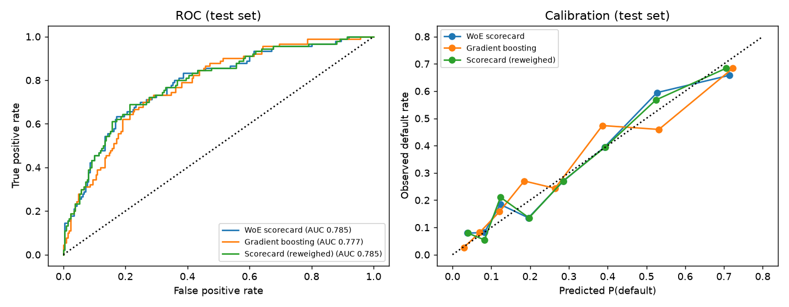
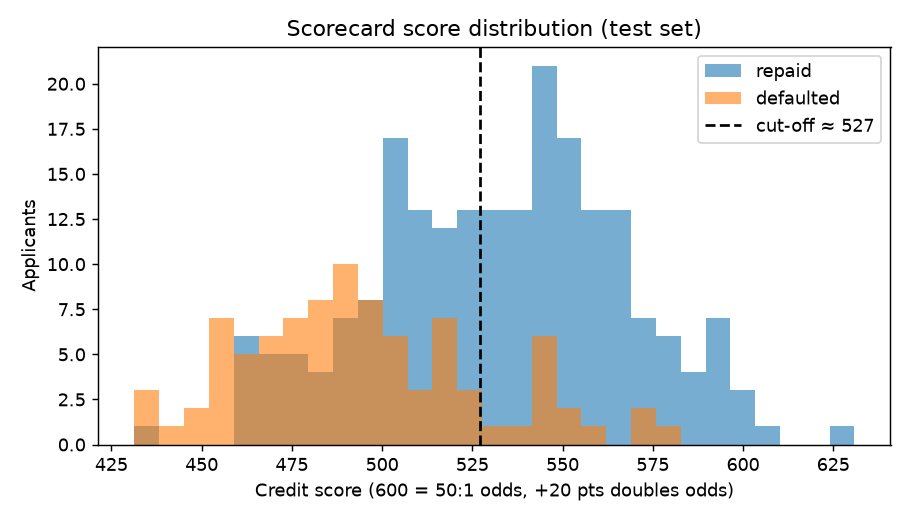
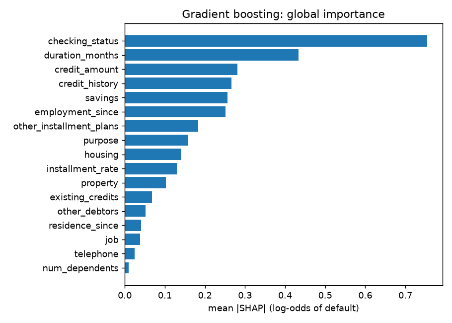
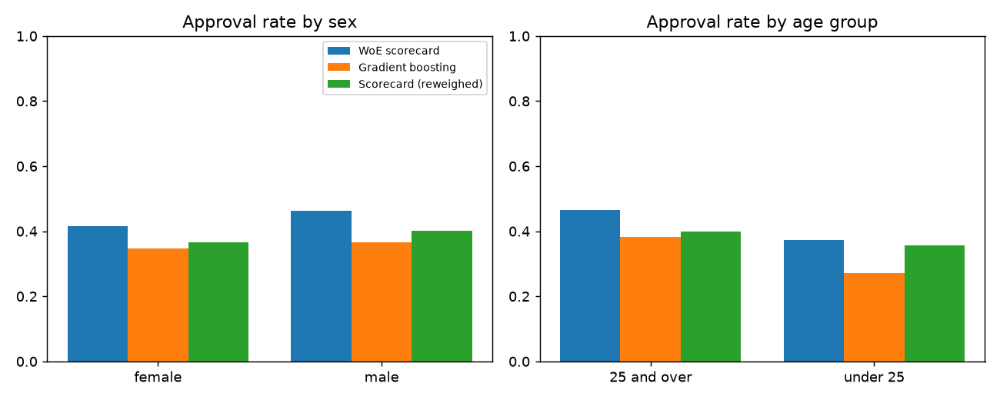

# fair-credit

[](https://github.com/saamaaraiii/fair-credit/actions/workflows/ci.yml)


A credit scoring model that has to explain itself. I compare an old-school points scorecard with a gradient-boosting model, give a reason for every decision, audit both for bias by age and sex, try one way of reducing that bias, and serve the whole thing as an API in Docker.

The data is the Statlog German Credit dataset from UCI (1,000 applicants).

Why bother with all the explanation and fairness work? Credit scoring is classed as high-risk under the EU AI Act, and UK GDPR Article 22 gives people rights over automated decisions made about them. A lender can't just say "the model said no". It has to say why, and show the model isn't discriminating.

## What's in here

**The scorecard** is built from scratch: Weight-of-Evidence binning, Information Value to pick features, logistic regression, then scaled to points (600 = 50:1 odds, every +20 points doubles the odds). The points for each feature add up exactly to the final score, and a test checks that.

**The challenger** is gradient boosting with monotonic constraints, so a longer loan can never make someone look safer. It's explained with exact SHAP values.

**Decisions are cost-sensitive.** The dataset comes with a 5:1 cost matrix (approving someone who defaults costs five times more than turning away someone who'd have paid), so the approval threshold minimises that cost. It's chosen on out-of-fold predictions within the training set, so the test set only gets used once, at the end.

**The fairness audit** looks at disparate impact (the four-fifths rule), equal opportunity and calibration by sex and by age, all with 95% bootstrap intervals.

**For mitigation** I tried Kamiran-Calders reweighing. It moves the age disparate impact ratio from 0.80 to 0.89 without costing any AUC.

The rest is a typed FastAPI service with input validation, a Docker image, a model card, CI, and 28 tests.

## Results (held-out test set, n = 300)

| Model | CV AUC | Test AUC | Gini | KS | Brier | Approval rate | Bad rate among approved | Cost / applicant |
|---|---:|---:|---:|---:|---:|---:|---:|---:|
| WoE scorecard | 0.762 | 0.785 | 0.569 | 0.462 | 0.164 | 44.7% | 11.2% | 0.553 |
| Gradient boosting | 0.769 | 0.777 | 0.555 | 0.443 | 0.169 | 36.0% | 8.3% | 0.520 |
| Scorecard + reweighing | 0.760 | 0.785 | 0.571 | 0.475 | 0.164 | 39.0% | 11.1% | 0.570 |

For context, approving everyone costs 1.50 per applicant and rejecting everyone costs 0.70.

The plain scorecard ranks applicants just as well as gradient boosting. Boosting comes out a little cheaper, mostly because it approves fewer people. With only 1,000 rows I'd take the scorecard: you can read the entire model off one table.



## Explaining a decision

```bash
curl -s -X POST "localhost:8000/v1/score?model=scorecard" \
  -H "Content-Type: application/json" \
  -d '{"checking_status": "< 0", "duration_months": 24, "credit_history": "existing repaid duly",
       "purpose": "used car", "credit_amount": 4000, "savings": "< 100",
       "employment_since": "1-4 years", "installment_rate": 3, "other_debtors": "none",
       "residence_since": 2, "property": "car or other", "other_installment_plans": "none",
       "housing": "own", "existing_credits": 1, "job": "skilled employee",
       "num_dependents": 1, "telephone": "no"}'
```

```json
{
  "model": "scorecard",
  "probability_of_default": 0.3645,
  "credit_score": 503.2,
  "decision": "decline",
  "threshold": 0.2,
  "reasons": [
    {"feature": "checking_status", "value": "< 0",  "impact": 42.7},
    {"feature": "savings",         "value": "< 100", "impact": 30.5},
    {"feature": "duration_months", "value": "24",    "impact": 26.5},
    {"feature": "credit_history",  "value": "existing repaid duly", "impact": 14.1}
  ]
}
```

For the scorecard, `impact` is how many points the applicant lost on that feature compared with the best possible answer. With `?model=gbm` it's the SHAP contribution in log-odds. For this applicant both models give the same top three reasons (overdrawn current account, low savings, long loan), which is a decent sanity check.

| | |
|---|---|
|  |  |

The full points table is in [`reports/scorecard_points.csv`](reports/scorecard_points.csv).

## Fairness audit

Age, sex and nationality are never given to the models. I keep them aside and only use them to audit the decisions. I left `foreign_worker` out of the audit: only 37 of the 1,000 applicants (9 in the test set) are in the minority group, which is far too few to say anything.

| Model | Attribute | Disparate impact ratio | Equal-opportunity gap |
|---|---|---:|---:|
| Scorecard | sex | 0.90 [0.68, 0.99] | 0.01 [0.00, 0.17] |
| Scorecard | age (<25 vs 25+) | 0.80 [0.53, 0.99] | 0.06 [0.00, 0.25] |
| Gradient boosting | age | 0.71 [0.42, 0.98] | 0.06 [0.00, 0.25] |
| Scorecard + reweighing | age | 0.89 [0.57, 0.99] | 0.02 [0.00, 0.23] |

*95% bootstrap intervals in brackets. The disparate impact ratio is the lower group's approval rate divided by the higher one's. Under 0.8 fails the four-fifths rule of thumb.*



A few things came out of this.

Leaving age out of the model doesn't stop it treating young people differently. Under-25s still get approved less often, because things like short employment history and renting stand in for age. Gradient boosting picks up on those proxies even more (ratio 0.71).

The fairness definitions also pull against each other. Under-25s in this data really do default more (47.5% vs 25.7%). With age left out, the scorecard actually under-predicts their risk (31.7%), so it's miscalibrated for them and still approves them less often. When base rates differ you can't have calibration, equal approval rates and equal error rates all at once (Kleinberg et al., 2016). Picking which one matters is a policy call, not something the model can settle.

Reweighing is a cheap fix and it did help. Weighting the training data so default rates match across age groups lifted the ratio from 0.80 to 0.89 and shrank the equal-opportunity gap, with the same AUC and about 3% more expected cost. Age only sets the training weights. It's never used when scoring someone.

One caveat: the intervals are wide. There are only 59 under-25s in the test set, so none of these differences is conclusive. A real lender would need far more data and ongoing monitoring.

## Running it

```bash
git clone https://github.com/saamaaraiii/fair-credit.git && cd fair-credit
pip install -e ".[dev]"
python -m faircredit.train          # trains, evaluates, audits; writes models/, reports/, docs/
pytest
uvicorn faircredit.api:app --reload # API docs at http://127.0.0.1:8000/docs
```

Or with Docker:

```bash
docker build -t fair-credit . && docker run -p 8000:8000 fair-credit
```

| Endpoint | What it does |
|---|---|
| `GET /health` | liveness check |
| `GET /v1/models` | available models, thresholds and test metrics |
| `POST /v1/score?model=scorecard\|gbm\|scorecard_reweighed` | decision, PD, score and reasons |

## Notes

SHAP's `TreeExplainer` will happily run on scikit-learn's gradient boosting with native categorical splits, but the values it returns don't add up to the model's output, so the explanations are quietly wrong. That's why the model one-hot encodes its inputs (TreeExplainer is exact there) and then sums the one-hot contributions back into each original feature. `test_shap_values_are_additive` is there to make sure this never comes back.

The WoE bins, thresholds and reweighing weights are all fitted inside the training folds, so nothing leaks from the test set.

The API's categorical fields are `Literal` types, so something like `purpose: "yacht"` gets a 422 instead of being silently treated as some default.

The intended use and limitations are in [MODEL_CARD.md](MODEL_CARD.md).

## Layout

```
src/faircredit/
  data.py        decode the UCI codes, split features from protected attributes
  scorecard.py   WoE binning, Information Value, points scorecard, reason codes
  models.py      gradient-boosting pipeline, AUC/Gini/KS/Brier, cost-optimal threshold
  explain.py     exact SHAP, mapped back to the original features
  fairness.py    group metrics, bootstrap CIs, reweighing
  train.py       training, evaluation, audit and charts
  api.py         FastAPI service
data/german.data the original UCI file
reports/         metrics.json, scorecard_points.csv, summary.md
```

## Data and references

- Hofmann, H. (1994). *Statlog (German Credit Data)*. UCI Machine Learning Repository. [doi:10.24432/C5NC77](https://doi.org/10.24432/C5NC77). CC BY 4.0.
- Siddiqi, N. (2017). *Intelligent Credit Scoring* (2nd ed.). Wiley.
- Lundberg, S. & Lee, S. (2017). *A unified approach to interpreting model predictions*. NeurIPS.
- Kamiran, F. & Calders, T. (2012). *Data preprocessing techniques for classification without discrimination*. KAIS.
- Hardt, M., Price, E. & Srebro, N. (2016). *Equality of opportunity in supervised learning*. NeurIPS.
- Kleinberg, J., Mullainathan, S. & Raghavan, M. (2016). *Inherent trade-offs in the fair determination of risk scores*. arXiv:1609.05807.
